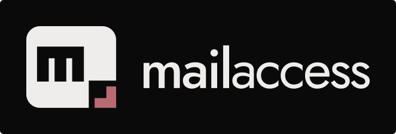
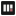
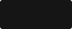

<a href="../README.md">
  <picture>
    <source media="(prefers-color-scheme: dark)" srcset="../assets/brand/mailaccess-logo-reversed.svg">
    
  </picture>
</a>

# Brand

Identity kit, 13 assets, in the same colours as the mailaccess.pro design system. Everything here is vector, drawn as paths, with no font or network dependency. Source files live in [`assets/brand/`](../assets/brand).

---

## Lockups

**01 · Primary horizontal.** The default, for paper and light backgrounds. Icon and wordmark share cap height.

**02 · Stacked.** For square-ish spaces where the horizontal lockup would set too small.

**03 · Reversed.** Dark UI. The envelope and wordmark switch to `#EEEDEC` and the stroke to `#0B0A0B`. The corner stays dusty rose.

**04 · Single colour.** All ink `#151515`. Print, embroidery, anywhere the accent cannot survive.

**05 · Single colour accent.** All dusty rose. Rare: merchandise or one small placement. Never next to 01, and never as a large area.

**06 · Wordmark.** Outlined lowercase `mailaccess`, with a weight break between `mail` and `access`.

---

## Profile & app marks

| | | | |
|:-:|:-:|:-:|:-:|
|  |  |  |  |
| **07** · social 400 | **08** · avatar light | **09** · app icon | **10** · app icon alt |

---

## Favicons

Progressively simplified: the mark is redrawn at each size, not scaled down.

| | | |
|:-:|:-:|:-:|
|  |  |  |
| **11 · 64px**: full mark | **12 · 32px**: heavier strokes, single corner bar | **13 · 16px**: three bars, accent block |

---

## The mark

Same geometry everywhere. Only the colours change with the background.

| Part | On dark | On paper |
|------|---------|----------|
| Envelope | `#EEEDEC` | `#151515` |
| Stroke (the `m`) | `#0B0A0B` | `#F3F2F0` |
| Corner | `#B86A73` | `#B86A73` |

---

## Palette

Near-neutral charcoal, light text, and one accent used rarely.

| | Name | Hex | Role |
|-|------|-----|------|
|  | **dusty rose** | `#B86A73` | The only accent. Small marks only: the logo corner, a dot, a prompt `$`, hint text. Never a large area, never a button fill. |
|  | **ink** | `#151515` | The mark and text on paper. |
|  | **muted** | `#9A9796` | Notes, eyebrows, inactive tabs. The dimmest grey allowed for text. Never the mark. |

Surfaces and text:

| Token | Hex | Use |
|-------|-----|-----|
| `--bg` | `#0B0A0B` | Page background (dark) |
| `--surface` | `#121113` | Cards, panels |
| `--surface-2` | `#18171A` | Raised elements, hovers, inner wells |
| `--text` | `#EEEDEC` | Headings, primary text on dark |
| `--text-2` | `#ABA9A8` | Body copy, subtitles on dark |
| `--muted` | `#9A9796` | Small notes on dark |
| `--paper` | `#F3F2F0` | Light objects that deserve attention |
| `--ink` | `#151515` | Text and the mark on paper |

Never use pure `#000` or `#fff` for surfaces.

---

## Typography

| Face | Use | Setting |
|------|-----|---------|
| **Geist** | Headings, body, UI | Headings at 600 with tight negative tracking; body at 400 |
| **Geist Mono** | Data, commands, eyebrows | Eyebrows 12px uppercase, tracking 0.06em, colour `#9A9796` |

Both are SIL OFL. Self-host them; don't load them from a CDN. The shipped lockups have the wordmark converted to outlines, so **no font needs to be installed to render them**.

---

## Clearspace

Minimum clearspace is **½ the mark height** on all four sides. Nothing enters that box: no text, no rules, no other logos.

---

## Rules

- Use **01** on paper and **03** on dark unless there is a reason not to.
- On dark, use **03**, not 01 with the background knocked out.
- Never recolour the mark outside the variants above.
- Keep the accent rare. One small rose mark per view is the norm; it should never fill a large area.
- Never stretch, rotate, outline, or add effects (glows, gradients, shadows) to the mark.
- Never rebuild the wordmark by typing `mailaccess` in a font. Use the shipped outlines.

---

## Files

| File | Asset |
|------|-------|
| [`mailaccess-logo.svg`](../assets/brand/mailaccess-logo.svg) | 01 · primary horizontal |
| [`mailaccess-logo-stacked.svg`](../assets/brand/mailaccess-logo-stacked.svg) | 02 · stacked |
| [`mailaccess-logo-reversed.svg`](../assets/brand/mailaccess-logo-reversed.svg) | 03 · reversed, dark UI |
| [`mailaccess-logo-mono.svg`](../assets/brand/mailaccess-logo-mono.svg) | 04 · single colour |
| [`mailaccess-logo-accent.svg`](../assets/brand/mailaccess-logo-accent.svg) | 05 · single colour accent |
| [`mailaccess-wordmark.svg`](../assets/brand/mailaccess-wordmark.svg) | 06 · wordmark |
| [`mailaccess-avatar-dark.svg`](../assets/brand/mailaccess-avatar-dark.svg) | 07 · social 400 |
| [`mailaccess-avatar-light.svg`](../assets/brand/mailaccess-avatar-light.svg) | 08 · avatar light |
| [`mailaccess-icon.svg`](../assets/brand/mailaccess-icon.svg) | 09 · app icon |
| [`mailaccess-icon-accent.svg`](../assets/brand/mailaccess-icon-accent.svg) | 10 · app icon alt |
| [`favicon-64.svg`](../assets/brand/favicon-64.svg) | 11 · 64px |
| [`favicon-32.svg`](../assets/brand/favicon-32.svg) | 12 · 32px |
| [`favicon-16.svg`](../assets/brand/favicon-16.svg) | 13 · 16px |

Press and sponsor enquiries: see [SPONSORSHIP.md](../SPONSORSHIP.md).
